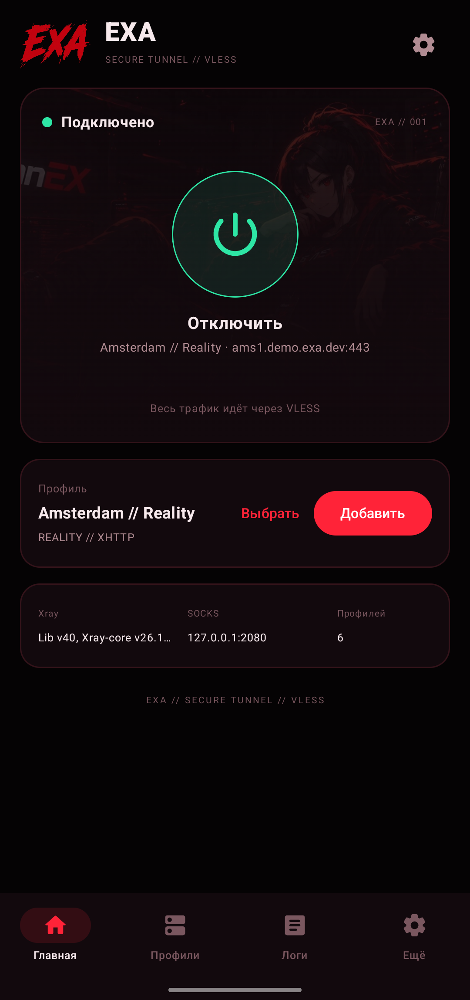
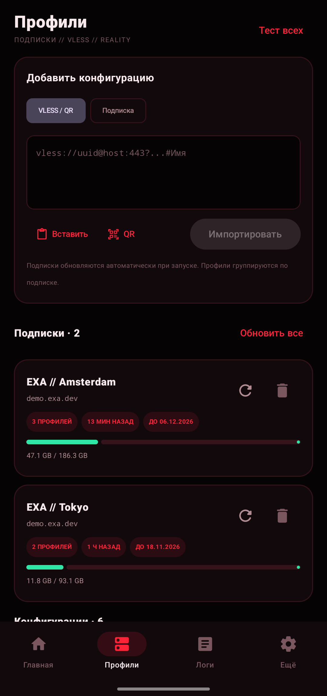
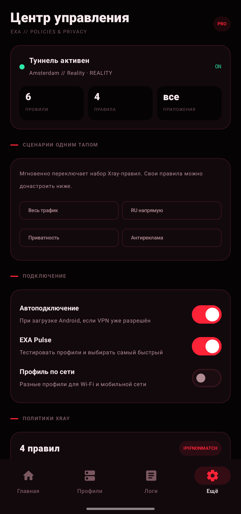
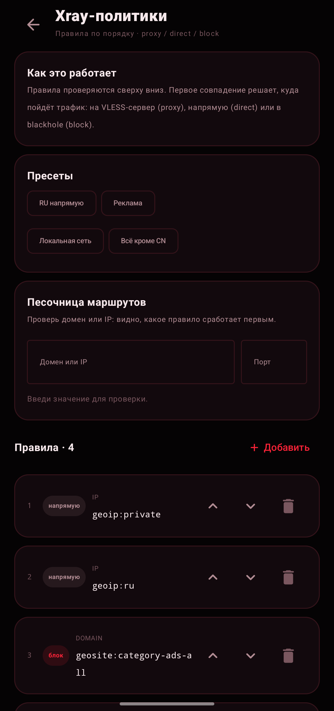
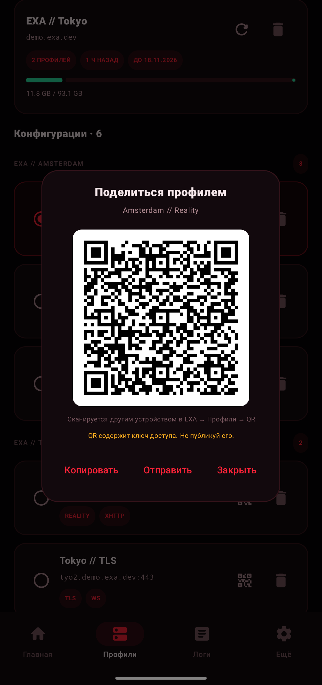
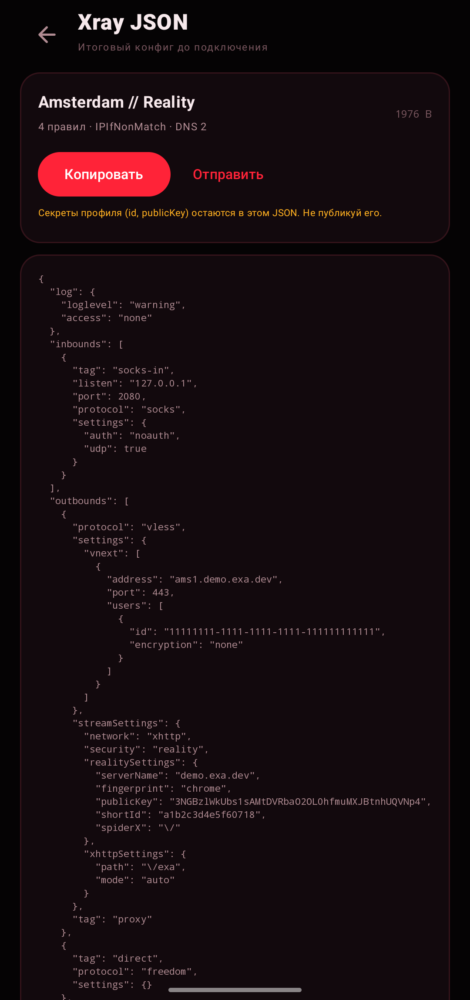
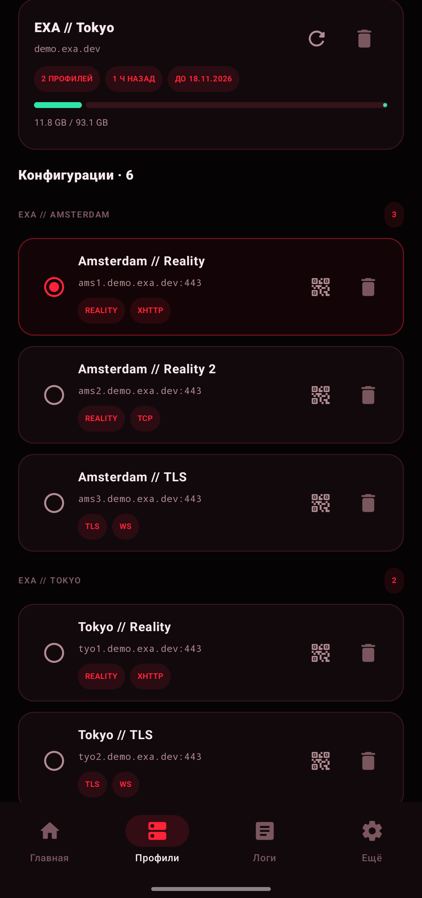
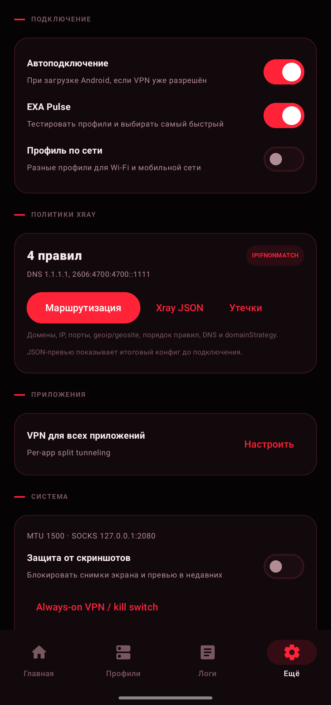

# EXA — Android VPN client

<p align="center">
  
</p>

Нативный Android-клиент **EXA** в фирменном стиле: тёмный интерфейс, красный
акцент, логотип EXA. Весь системный трафик идёт через **VLESS/Reality**:
`VpnService` → `hev-socks5-tunnel` → локальный SOCKS5 → **xray-core** → сервер.

Android 10+ (API 29). Без рекламы, аналитики и сторонних SDK.

## Что умеет

### Подписки как в Happ

- Добавление HTTPS-подписки по URL и названию.
- Профили сразу появляются в списке и группируются по подписке.
- Автообновление устаревших подписок при запуске (раз в 6 часов).
- Ручное обновление одной подписки или всех сразу.
- Трафик и срок действия из заголовка `Subscription-Userinfo`
  (`upload/download/total/expire`) с прогресс-баром.
- Название из `Profile-Title` / `Content-Disposition`, если провайдер его отдаёт.
- Ошибки обновления видны на карточке подписки; старые профили не теряются.

### Импорт и QR

- `vless://` — одна ссылка или несколько строк.
- Base64-подписки (как обычный текст).
- **QR-сканер** камерой: `vless://`, URL подписки или обычный текст.
  Работает полностью офлайн на ZXing, без Google Play Services и ML Kit.
- **QR-шаринг профиля**: показать QR, скопировать ссылку, отправить.
- Открытие `vless://` из браузера/Telegram через deep link.

### Маршрутизация и политики Xray

- Полноценный редактор правил: **домен / IP / порт**, действие
  **proxy / direct / block**.
- Поддержка `domain:`, `full:`, `regexp:`, `geosite:`, `geoip:`, CIDR,
  wildcard-доменов, диапазонов портов и списков через запятую.
- Порядок правил меняется стрелками — первое совпадение решает.
- DNS-серверы (IP, `tls://`, `https://`) и `domainStrategy`:
  `AsIs`, `IPIfNonMatch`, `IPOnDemand`.
- Пресеты: «RU напрямую», «Реклама», «Локальная сеть», «Всё кроме CN».
- **Сценарии одним тапом**: весь трафик / RU напрямую / приватность / антиреклама.
- **Песочница маршрутов**: ввести домен/IP/порт и увидеть, какое правило
  сработает первым (с пометкой, что `geoip/geosite` проверяются только в Xray).
- **Превью итогового Xray JSON** с копированием и отправкой — до подключения.
  Секреты профиля не покидают устройство без действия пользователя.

### Удобство

- **EXA Pulse**: тест задержки профилей и автовыбор самого быстрого.
- **Профиль по сети**: отдельные профили для Wi-Fi и мобильной сети.
- **Per-app split tunneling**: только выбранные приложения или все, кроме выбранных.
- **Проверка утечек**: реальный IP vs IP через туннель.
- **Плитка в шторке** Quick Settings: один тап — подключить/отключить.
- Кнопка «Отключить» в foreground-уведомлении.
- Автоподключение после загрузки Android.
- Always-on VPN / kill switch — быстрый переход в системные настройки.
- Логи Xray/VPN/HEV и версия ядра.
- **Защита от скриншотов** (FLAG_SECURE) — опционально.
- Тёмная тема, адаптивная иконка, hero-графика бренда.

## Установка

1. Скачай `EXA-0.1.0.apk` из [релизов](https://github.com/GretskyOleg/exa-android/releases).
2. Разреши установку из неизвестного источника.
3. Открой EXA → «Профили» → добавь `vless://`, QR или HTTPS-подписку.
4. Нажми «Подключить» и разреши VPN.

APK подписан локальным ключом EXA. Обновления должны ставиться поверх с тем же
ключом.

## Скриншоты

<p align="center">
  
  
  
</p>
<p align="center">
  
  
  
</p>
<p align="center">
  
  
</p>

## Сборка

Нужны: JDK 21, Android SDK (platform 35, build-tools 35.0.0), Gradle 8.10+.

```bash
./scripts/download-libs.sh      # libv2ray.aar + hev-socks5-tunnel.aar (SHA-256)
./scripts/download-geodata.sh   # geoip.dat + geosite.dat (SHA-256)
./gradlew assembleDebug         # debug APK
./gradlew assembleRelease       # release APK (нужен keystore.properties)
```

APK:

```
app/build/outputs/apk/debug/app-debug.apk
app/build/outputs/apk/release/app-release.apk
```

`local.properties` с `sdk.dir=...` создаётся локально и не коммитится.
`app/libs/*.aar`, `keystore.properties` и `keystore/` — в `.gitignore`.

### Release-подпись

```bash
keytool -genkeypair -v -keystore keystore/exa-release.jks \
  -alias exa -keyalg RSA -keysize 2048 -validity 10000 \
  -storepass '...' -keypass '...' -dname "CN=EXA, O=EXA, C=RU"

cat > keystore.properties <<'EOF'
storeFile=keystore/exa-release.jks
storePassword=...
keyAlias=exa
keyPassword=...
EOF
```

Без `keystore.properties` release собирается debug-ключом (только для тестов).

## Архитектура

```
MainActivity (Compose)
  └─ VpnController ── VpnService.prepare ── ExaVpnService
                                              ├─ VpnService.Builder → TUN fd
                                              ├─ GeoAssets → geoip.dat / geosite.dat
                                              ├─ XrayBridge → Libv2ray.startLoop(config, 0)
                                              │    └─ SOCKS5 127.0.0.1:2080
                                              └─ HevTunnel → TProxyStartService(hev.yaml, fd)
                                                   └─ TUN ⇄ SOCKS5 ⇄ xray ⇄ VLESS
```

- `Libv2ray` — AndroidLibXrayLite (xray-core через gomobile), версия закреплена.
- `hev-socks5-tunnel` — TUN-to-SOCKS5 (TCP + UDP), версия закреплена.
- Приложение исключено из VPN (`addDisallowedApplication`), чтобы upstream
  xray не заворачивался сам в себя.
- SOCKS-порт проверяется после старта Xray: «Подключено» появляется только
  когда inbound реально принимает соединения.

## Безопасность

- Подписки только **HTTPS**, до 4 HTTPS-редиректов, лимит 2 МБ, таймауты.
- Импорт ограничен по длине; домен профиля валидируется по ASCII-набору.
- `allowBackup=false`, `usesCleartextTraffic=false`, network security config.
- Нет `QUERY_ALL_PACKAGES`: список приложений через `<queries>` MAIN/LAUNCHER.
- Нет Firebase/ML Kit/аналитики; QR-декодер — офлайн ZXing.
- Логи в logcat только в debug-сборке; release не пишет события наружу.
- Экспортированы только необходимые компоненты; BootReceiver — `exported=false`.
- SHA-256 нативных AAR и geo-баз проверяется при скачивании.
- Опциональный `FLAG_SECURE` против скриншотов и превью в «недавних».
- Подробнее: [docs/SECURITY.md](docs/SECURITY.md).

## Ограничения

- Только VLESS (Reality/TLS/WS/gRPC/XHTTP/HTTPUpgrade/KCP).
- Подписки: текст/base64 с `vless://`; JSON-форматы панелей не поддерживаются.
- Нет встроенного обновления приложения (ставится APK поверх).
- Release APK подписан локальным ключом; храни его для обновлений.

## Лицензия

MIT. См. [LICENSE](LICENSE).
